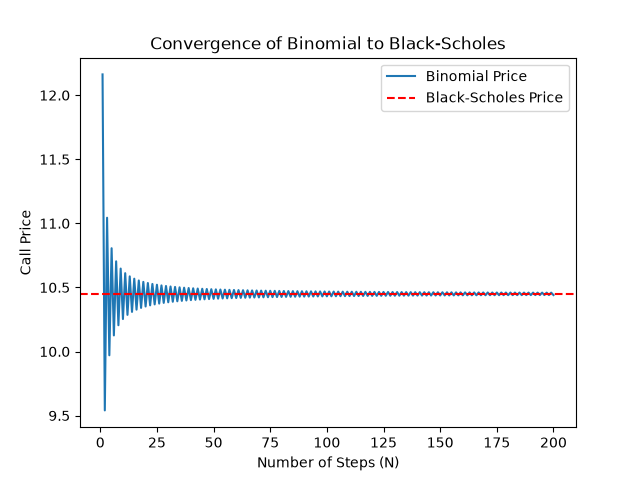

# Binomial Option Pricer
A Python option pricer built from scratch with the binomial model, starting from a one-step tree and adding one concept per stage. *(Work in progress.)*


 
## Why I built this
As a first-year Financial Mathematics student, I wanted to understand how options are actually priced by building a model myself, not just by learning the formulas.

The binomial model was a natural place to start. The first step can be worked out by hand with pen and paper, and each stage adds one new idea on top, so I could check every step as I built it.
 
## How it works
The model assumes that the price of a stock will either go up or down over each time step. After an up move, the price becomes $S \times u$, and after a down move, $S \times d$, where $u$ and $d$ are set by the volatility $\sigma$ as follows:
 
```math
\Delta t = \frac{T}{N}, \qquad u = e^{\sigma\sqrt{\Delta t}}, \qquad d = \frac{1}{u} = e^{-\sigma\sqrt{\Delta t}}
```
<br>

Where $T$ is the time to maturity in years and $N$ is the number of steps. $\sigma$ is the annual volatility, written as a decimal (so 20% is 0.2): the standard deviation of the stock's log-returns over one year, i.e. how widely the stock's returns spread out.

Scaling by $\sqrt{\Delta t}$ means the log-price has the same total variance, $\sigma^2 T$, no matter how many steps the tree has, so adding steps makes the option price converge towards the Black-Scholes price rather than changing how much the stock moves.

Setting $d = 1/u$ means an up move followed by a down move returns the price exactly to $S$, so the tree stays centred on today's price and each step moves the log-price by the same amount up or down. (For example, with $u = 1.2$ and $d = 0.8$, an up then down move takes 100 to 96, but with $d = 1/u \approx 0.833$ it returns to exactly 100.)

We calculate the risk-neutral probability $p$: the probability of an up move that makes the stock grow, on average, at exactly the risk-free rate. The formula for $p$ is:

```math
p = \frac{e^{r\Delta t} - d}{u - d}
```
<br>

Where $r$ is the annual risk-free interest rate (continuously compounded), so $e^{r\Delta t}$ is how much £1 grows over one step.

For $p$ to be a valid probability (between 0 and 1), we need $d < e^{r\Delta t} < u$. This is the no-arbitrage condition: if the stock were guaranteed to beat the risk-free rate (or guaranteed to lose to it), you could make a risk-free profit. The code checks this condition and raises an error if it fails.
 
When we reach the final column of the tree, we can calculate what the option is worth if you exercise it, using:
 
```math
V = \max(S_T - K, 0)
```
<br>

Where $S_T$ is the stock price at the final point and $K$ is the strike price, the price at which the option lets you buy the stock. Therefore, if the stock price ends below the strike price, the call would simply not be exercised, meaning the value of the final payoff never drops below 0.

A put is the opposite: it lets you sell the stock at $K$, so it pays off when the price falls:

```math
V = \max(K - S_T, 0)
```
<br>

Only the payoff changes. Everything else in the tree ($u$, $d$, $p$ and the stepping back) stays exactly the same.
 
Finally, we calculate the fair price of the option today $(t = 0)$ using backward induction. At each point, the option's calculated value is the p-weighted average of the two points after it, divided by $e^{r\Delta t}$ to account for interest.

We repeat this process column by column, taking in each newly calculated fair price as the input for the next price, until we reach today:
 
```math
V = \frac{pV_{\text{up}} + (1-p)V_{\text{down}}}{e^{r\Delta t}}
```
<br>

We divide by $e^{r\Delta t}$ because £1 received one step from now is worth less than £1 today.

### Put-call parity
A European call and put with the same $S$, $K$, $r$ and $T$ must satisfy:

```math
C - P = S - Ke^{-rT}
```
<br>

Owning a call and selling a put means that at maturity you buy the stock for $K$ whatever happens: if the price is above $K$ you use your call, and if it's below $K$ the put buyer makes you buy. That's worth the stock today minus $K$ discounted back to today. The code uses this as a free check: if $C$ and $P$ don't satisfy it, one of them is wrong.

### American options (early exercise)
A European option can only be exercised at maturity, but an American option can be exercised at any step. At every point in the tree the holder chooses between:

- **Keeping it**, worth the continuation value: the discounted, p-weighted average from backward induction.
- **Exercising it now**, worth the exercise value: the payoff using the stock price at that point.

They pick whichever is bigger:

```math
V = \max(\text{continuation value},\ \text{exercise value})
```
<br>

To get the exercise value, we need the stock price at each point while stepping back. At step $n$, the point $i$ places from the top has had $n - i$ up moves and $i$ down moves, so its price is $S \times u^{n-i} \times d^{i}$.

For a put, early exercise can be worth it: if the stock has crashed, you'd rather have $K$ now and earn interest on it than wait. So the American put is worth at least as much as the European one. For a call on a stock that pays no dividends, exercising early is never worth it (you'd pay $K$ sooner and lose the protection if the price falls), so the American call equals the European call.

Because of this, put-call parity no longer holds exactly for American options. It becomes a range:

```math
S - K \le C - P \le S - Ke^{-rT}
```
<br>

The gap between $S - Ke^{-rT}$ and $C - P$ is exactly the put's early-exercise premium.

### Black-Scholes comparison
As $N$ gets very large, the tree turns into the Black-Scholes model, which prices a European option with one formula and no tree:

```math
d_1 = \frac{\ln(S/K) + \left(r + \tfrac{1}{2}\sigma^2\right)T}{\sigma\sqrt{T}}, \qquad d_2 = d_1 - \sigma\sqrt{T}
```

```math
C = S\,N(d_1) - Ke^{-rT}N(d_2), \qquad P = Ke^{-rT}N(-d_2) - S\,N(-d_1)
```
<br>

Where $N(x)$ is the probability that a standard normal random number is below $x$. The code works this out with Python's error function, `math.erf`, so it needs no extra libraries. Roughly, $N(d_2)$ is the risk-neutral probability that the call ends up being exercised, so the call price is the value of the stock you receive minus the discounted strike you pay, each weighted by the chance it happens.

Because Black-Scholes gives the exact price the tree is heading towards, it's the perfect check: if the tree is right, the gap between the two should shrink towards 0 as $N$ grows.
 
## How I built it
1. [One-step tree](stages/01_one_step.py): priced a call with a single up/down move, using the risk-neutral probability.
2. [Two-step tree](stages/02_two_step.py): scaled up to two up/down moves, and introduced backward induction.
3. [N-step tree](stages/03_n_step.py): scaled up to an n-step tree, using loops to build the tree and step back through it for any number of steps.
4. [Interest rates](stages/04_interest_rates.py): added a continuously compounded annual rate $r$ over time to maturity $T$, which changes $p$ and discounts each step back by $e^{r\Delta t}$, plus a no-arbitrage check.
5. [Cox-Ross-Rubinstein](stages/05_crr.py): replaced manually assigned $u$ and $d$ with ones calculated from volatility, so the option price converges towards the Black-Scholes price as $N$ grows.
6. [Puts and put-call parity](stages/06_puts.py): added European puts by changing only the payoff, merged calls and puts into one function, and checked them against each other with put-call parity.
7. [American options](stages/07_american.py): added early exercise by comparing the continuation value with the exercise value at every point, and checked that the American call equals the European call. At $N = 100$ the American put is worth 6.0824 against 5.5536 for the European put, an early-exercise premium of 0.5288.
8. [Black-Scholes comparison](stages/08_black_scholes.py): added the Black-Scholes formula for calls and puts, then compared it with the tree for increasing $N$ and plotted the convergence chart above.

## Results
For a call with $S = K = 100$, $r = 0.05$, $T = 1$ and $\sigma = 0.2$, the Black-Scholes price is 10.4506. The tree gets closer as $N$ grows:

| $N$ | Tree price | Gap from Black-Scholes |
|---|---|---|
| 1 | 12.1623 | +1.7117 |
| 2 | 9.5405 | −0.9101 |
| 5 | 10.8059 | +0.3554 |
| 10 | 10.2534 | −0.1972 |
| 50 | 10.4107 | −0.0399 |
| 100 | 10.4306 | −0.0200 |
| 101 | 10.4680 | +0.0174 |
| 500 | 10.4466 | −0.0040 |
| 1000 | 10.4486 | −0.0020 |

Two things stand out:

- **The price zig-zags towards the answer.** Odd $N$ are slightly too high and even $N$ slightly too low. With $S = K$, an even number of steps puts one final stock price exactly on the strike, while an odd number puts the strike between two final prices, so the payoff $\max(S_T - K, 0)$ is approximated differently and the error flips sign.
- **The error shrinks roughly in proportion to $1/N$.** Going from $N = 100$ to $N = 1000$ makes the gap about 10 times smaller (from 0.0200 to 0.0020).

## How to run it
Requires Python 3. Stages 1–7 need no extra libraries. Stage 8 uses matplotlib for the convergence chart.

Run from the repository root so the chart saves to `images/`:
 
    python stages/08_black_scholes.py
 
## Roadmap
- [x] One-step tree
- [x] Two-step tree (backward induction)
- [x] N-step tree
- [x] Interest rates
- [x] Volatility-based u and d (Cox-Ross-Rubinstein)
- [x] Puts and put-call parity
- [x] American options (early exercise)
- [x] Black-Scholes comparison and convergence chart
- [ ] Implied volatility (bisection and Newton's method)
- [ ] Delta and hedging